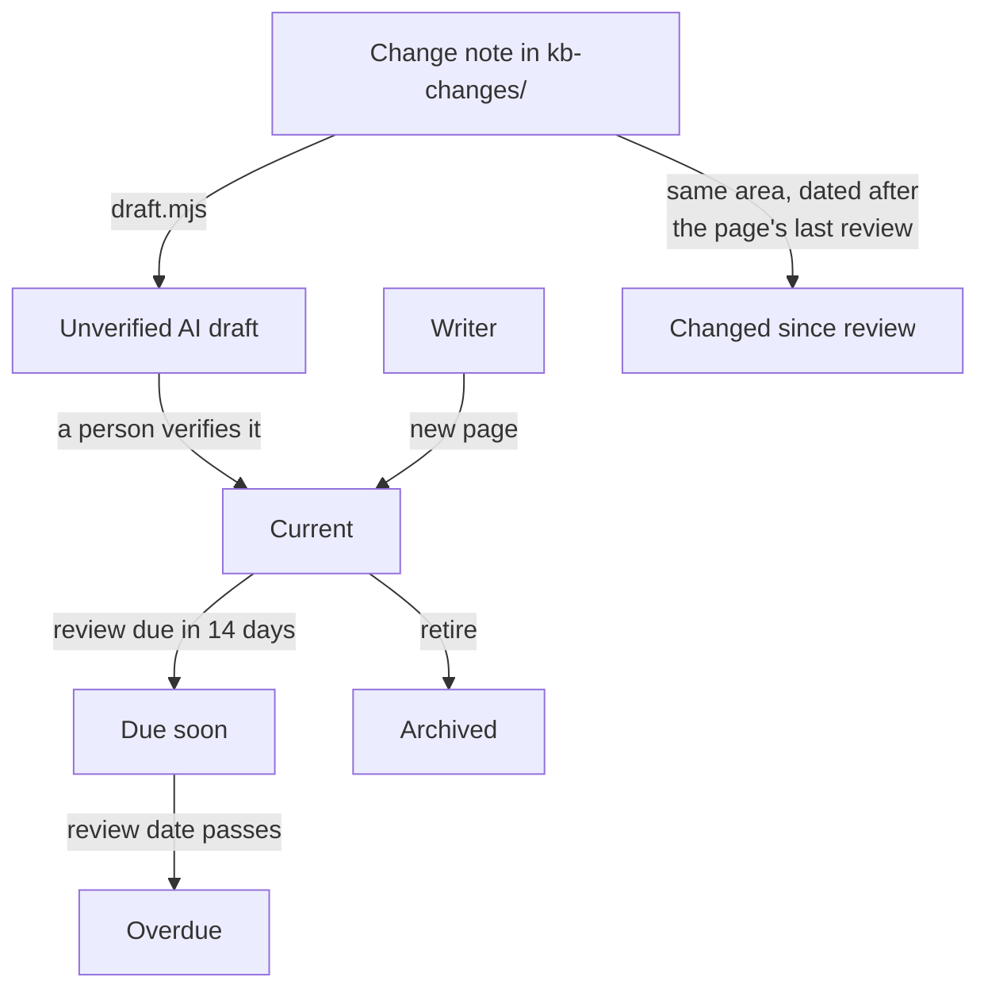

# A knowledge base that audits itself

This section is a working sample of a single-source knowledge base. Each page records who owns it and when it was last checked. A build script reads those records, flags pages that need review, and blocks AI-drafted pages until a person signs off on them.

:::note[Quillon is fictional]
Quillon is an invented litigation workspace. The product, its settings, and its teams exist only to give the pipeline something to manage. The pipeline, scripts, and checks are working code in [this repository](https://github.com/avalynn-circe/circe-docs).
:::

## The problem this solves

A product knowledge base goes stale in two ways. Time passes and nobody rereads a page. Or the product changes and nobody connects the change to the pages it breaks. The second kind is harder to catch, because a page can be three weeks old and already wrong.

AI drafting adds a third risk. A model can write a plausible page fast, and a plausible page with one wrong setting is worse than no page. Sales, customer success, and clients all read the same source, so one error reaches everyone.

## How a page moves through its lifecycle



A review returns any flagged page to **Current** and resets its review date.

A product change starts as a short change note in `kb-changes/`. The note names the product areas it touches. From there it does two jobs: it can seed an AI draft of a new page, and it flags every existing page in the same areas for review.

## What each page records

Every page in this section starts with front matter like this:

```yaml
title: Export a privilege log
owner: discovery-squad
audience: [internal, client]
areas: [privilege, production]
status: current
last_reviewed: 2026-06-30
review_every: 90
```

| Field | Purpose |
|---|---|
| `owner` | The team that answers for the page. The review queue groups work by owner. |
| `audience` | Who reads it: `internal` teams, `client` users, or both. |
| `areas` | Product areas the page depends on. Change notes match against these. |
| `status` | `current`, `ai-draft`, or `archived`. |
| `last_reviewed`, `review_every` | The review date and the interval in days. |
| `drafted_from`, `verified_by`, `verified_on` | The trail for a page that began as an AI draft. |
| `archived_on`, `unlisted` | Retirement date. `unlisted: true` drops the page from the sidebar and search. |

## What each state means

| State | Trigger | Blocks merge |
|---|---|---|
| Unverified AI draft | `status: ai-draft` | Yes |
| Changed since review | A change note in one of the page's areas, dated after `last_reviewed` | No |
| Overdue | Today is past `last_reviewed` plus `review_every` | No |
| Due soon | The review date is 14 days away or less | No |
| Current | None of the above | No |
| Archived | `status: archived` | No |

Only unverified AI drafts block a merge. Stale pages go to a review queue, because a past-due page on one team should not stop an unrelated fix from shipping.

## What the pipeline enforces

| Check | Runs | On failure |
|---|---|---|
| Front matter schema: required fields, valid dates, a verifier on every AI-drafted page | Every pull request and push | Build fails |
| No `status: ai-draft` page | Every pull request and push | Build fails |
| No `TODO(verify)` marker left in a published page | Every pull request and push | Build fails |
| Circe Editorial Standard prose rules (Vale) | Every pull request and push | Error-level rules fail the build |
| Review queue: overdue, due soon, and changed pages | Every Monday | Opens or updates one GitHub issue, grouped by owner |
| [Doc health](./doc-health.md) dashboard | Every build, and a weekly scheduled deploy | Regenerated page |

## How an AI draft gets verified

1. A product manager or writer adds a change note to `kb-changes/` with the areas, audience, owner, and a plain description of the change.
2. The **Draft KB page** workflow sends the note, the related current pages, and the drafting rules in `scripts/kb/prompt.md` to Claude.
3. The workflow opens a pull request with the new page at `status: ai-draft`, labeled `ai-draft`. Facts the note left open appear as `TODO(verify)` lines.
4. The audit check fails on that pull request. That failure is the gate.
5. The owning team checks each claim against the change note and the product, resolves every `TODO(verify)`, and sets `status: current`, `verified_by`, `verified_on`, and `last_reviewed`.
6. The checks pass and the page can merge. The `drafted_from` field stays, so the page keeps a record of where it came from.

[Redact privileged text with redaction sets](./redaction-sets.md) went through this path. Its front matter shows the trail.

## Pages in this sample

- [Create a matter](./matters.md)
- [Run first-pass review with AI tagging](./first-pass-review.md)
- [Export a privilege log](./privilege-log.md)
- [Build a deposition outline from tagged exhibits](./deposition-outline.md)
- [Set up an ethical wall](./ethical-walls.md)
- [Redact privileged text with redaction sets](./redaction-sets.md)
